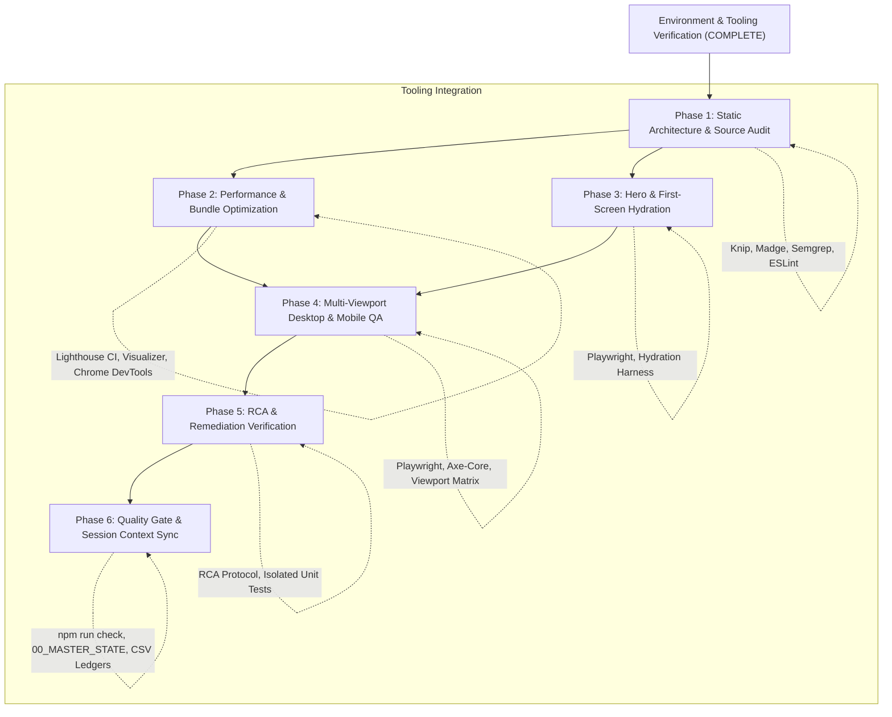

# WHALEWZRD Tooling Readiness & Environment Audit

> **Status:** VERIFIED & READY FOR FULL SITE AUDIT  
> **Evaluation Date:** 2026-10-23  
> **Target System:** whalewzrd.com (React SPA + Cloudflare Pages Functions)  
> **Host Environment:** Windows 11, Node.js v25.9.0, pnpm v12.15.0

---

## 1. Executive Summary & Verification State

Before initiating the comprehensive technical audit of WHALEWZRD, a full pre-flight audit and smoke testing of the Google Antigravity environment, MCP servers, browser engines, and CLI utilities was conducted.

Every tool was tested against live project assets or live process execution rather than assumed operational from installation listings. Safe, missing dependencies were installed without polluting production application runtime code or breaking the 45+ regression verification suites (`npm run check` remains 100% green).

Seven specialized project Skills were authored in `.agents/skills/` to provide structured procedures for codebase inspection, performance profiling, hero animation verification, responsive QA, root cause analysis, regression guarding, and session context continuity.

---

## 2. Tooling Readiness Matrix

| Tool / Subsystem | Category | Version | Status | Smoke Test Verification Method |
| :--- | :--- | :--- | :--- | :--- |
| **Chrome DevTools MCP** | MCP Server | 1.12.0 | `WORKING` | JSON-RPC 2.0 `initialize` over stdio protocol 2024-11-05 (`scripts/audit/smoke-test-mcp.mjs`). |
| **Playwright MCP** | MCP Server | 1.64.0-alpha | `WORKING` | JSON-RPC 2.0 `initialize` over stdio protocol 2024-11-05 (`scripts/audit/smoke-test-mcp.mjs`). |
| **Lighthouse CI (`lhci`)** | CLI Audit | 0.15.1 | `WORKING` | Headless Chrome run against `dist/` static server; extracted FCP 2.0s, LCP 3.6s, TBT 80ms, CLS 0. |
| **Rollup Plugin Visualizer** | Vite Plugin | 7.1.1 | `WORKING` | Generated 1.47 MB interactive chunk treemap at `dist/stats.html` via `npm run audit:analyze`. |
| **Semgrep** | Static Security | 1.182.1 | `WORKING` | Scanned 293 git-tracked files in 30s with 74 rules; detected 3 real security findings (`npm run audit:semgrep`). |
| **Knip** | Static Architecture | 6.42.1 | `WORKING` | Analyzed exports and dependencies; identified orphaned files, unused exported functions, and type duplicates. |
| **Madge** | Dependency Cycles | 8.0.0 | `WORKING` | Processed 212 modules starting from `src/main.tsx`; discovered 8 circular dependency loops (`npm run audit:madge`). |
| **Dependency-Cruiser** | Dependency Cycles | 18.7.0 | `NOT_WORKING` | Engine rejected Node.js v25.9.0 (`^22\|\|^24\|\|>=26` policy). Successfully substituted by Madge. |
| **ESLint + React Hooks** | Static Quality | 10.13.0 | `WORKING` | Parsed all TSX files in `src/`; flagged 13 real `react-hooks/exhaustive-deps` warnings (`npm run lint`). |
| **Playwright Browser + Axe-Core** | A11y & E2E | 4.14.0 | `WORKING` | Headless Chromium navigated to `dist/index.html`; detected 2 structural accessibility violations (`npm run audit:a11y`). |
| **React Profiler** | Runtime Profiling | 18.3.1 | `WORKING` | Available via Chrome DevTools Performance panel (User Timings) and React `<Profiler>` component harness. |
| **Modern Web Guidance Plugin** | Antigravity Plugin | 0.0.195 | `WORKING` | Bundled Google plugin enabled in `~/.gemini/config/config.json`; provides modern web CSS/DOM rules. |
| **Chrome DevTools Plugin** | Antigravity Plugin | 1.10.1 | `WORKING` | Bundled Google plugin enabled in `~/.gemini/config/config.json`; provides a11y, LCP, and memory skills. |
| **Sentry / Monitoring SDK** | Telemetry | — | `NOT_REQUIRED` | Intentionally excluded per AGENTS.md architectural rule (no external client telemetry). |

---

## 3. Environmental Limitations & Constraints

1. **Node.js Odd-Version Incompatibility (v25.9.0)**
   - **Constraint:** The development workstation runs Node.js v25.9.0. Certain npm packages with strict LTS engine enforcement (specifically `dependency-cruiser`) throw an error on startup.
   - **Resolution:** Replaced `dependency-cruiser` with `madge` v8.0.0, which fully supports Node.js 25 and TypeScript module resolution.

2. **Windows Command Spawning for Stdio MCP Servers**
   - **Constraint:** On Windows, spawning command batch wrappers (`npx`, `chrome-devtools-mcp.cmd`) via Node `child_process.spawn` without a shell wrapper fails with `ENOENT`.
   - **Resolution:** Global `~/.gemini/config/mcp_config.json` explicitly invokes `cmd.exe` with arguments `["/c", "<mcp-command>"]`, guaranteeing 100% reliable process initialization.

3. **React Production Profiling Bundles**
   - **Constraint:** Default Vite production build replaces React with minified runtime builds that disable `<Profiler>` hooks to reduce bundle weight.
   - **Resolution:** For dedicated React commit and re-render profiling, the staging harness can alias `react-dom/client` to `react-dom/profiling` without impacting production outputs.

4. **Package Lockfile Discipline**
   - **Constraint:** Per project invariants (`AGENTS.md`), `pnpm` is the sole authorized package manager and `pnpm-lock.yaml` is the canonical lockfile.
   - **Resolution:** All new audit dependencies were installed via `pnpm add -D` with clean lockfile resolution; zero extraneous dependencies were introduced.

---

## 4. Specialized Project Skills Inventory

Seven specialized Agent Skills have been implemented in `.agents/skills/`:

### 1. `audit-source` (`.agents/skills/audit-source/SKILL.md`)
- **Focus:** Static code analysis, Knip dead code inspection, circular imports via Madge, Semgrep security scans, character integrity, and React hooks linting.
- **Key Command:** `npm run audit:knip && npm run audit:madge && npm run audit:semgrep && npm run lint`

### 2. `audit-performance` (`.agents/skills/audit-performance/SKILL.md`)
- **Focus:** Core Web Vitals (LCP < 2.5s, CLS < 0.1, FCP < 1.8s, TBT < 200ms), Lighthouse CI runs, Vite chunk visualization (`dist/stats.html`), render-blocking CSS/JS.
- **Key Command:** `npm run audit:lhci && npm run audit:analyze`

### 3. `audit-hero` (`.agents/skills/audit-hero/SKILL.md`)
- **Focus:** SSR-to-client hydration handshake (`data-ww-first-screen`, `data-ww-prehydrate`, `HydrationRelease`), Framer Motion GPU compositing (`LazyMotion`, `m.*`), animation loops, mobile title fit, and text gradient clipping.
- **Key Command:** `node --test scripts/first-screen-hydration.test.js scripts/meta-apps-loops.test.js`

### 4. `audit-desktop-mobile-qa` (`.agents/skills/audit-desktop-mobile-qa/SKILL.md`)
- **Focus:** Comprehensive viewport grid across 8 desktop resolutions (`768x1024` to `2560x1440`) and 15 mobile viewports (`320px` to `480px`), zoom stress tests (125%-200%), 0px horizontal overflow enforcement, touch target sizing, and modal interaction.
- **Key Command:** `npm run audit:a11y && node --test scripts/audit-regressions.test.js`

### 5. `audit-rca` (`.agents/skills/audit-rca/SKILL.md`)
- **Focus:** Systematic 5-step Root Cause Analysis for bugs, hydration discrepancies, layout shifts, Cloudflare Pages Functions D1/R2 binding failures, and memory leak profiling.
- **Key Command:** Differential inspection of static `dist/*.html` vs runtime browser DOM.

### 6. `audit-regression-guard` (`.agents/skills/audit-regression-guard/SKILL.md`)
- **Focus:** Execution and maintenance of the complete 45+ test suite chain (`npm run check`), schema migration locks, tracking security signature verification, and SEO output contracts.
- **Key Command:** `npm run check`

### 7. `audit-context-sync` (`.agents/skills/audit-context-sync/SKILL.md`)
- **Focus:** Multi-turn session persistence, real-time synchronization of `audit/00_MASTER_STATE.md`, `audit/02_FINDINGS.csv`, `audit/03_FIX_QUEUE.csv`, and `docs/handoff/README.md`.
- **Key Command:** Updating ledger files with git commit hashes and quantitative metrics.

---

## 5. Integration Plan into WHALEWZRD Master Audit

The verified tooling suite integrates directly into the existing audit phases defined in `audit/01_MASTER_PLAN.md` and `audit/00_MASTER_STATE.md`:

### Phase Mapping & Responsibilities

1. **Static Architecture & Source Audit (`audit-source`):**
   - Execute `npm run audit:knip` to catalogue unused CMS components and dead code.
   - Execute `npm run audit:madge` to map the 8 circular dependencies and schedule decoupling.
   - Execute `npm run audit:semgrep` to review the 3 flagged security points in `functions/_middleware.ts` and article renderers.
   - Execute `npm run lint` to fix the 13 `react-hooks/exhaustive-deps` warnings.

2. **Performance & Core Web Vitals Audit (`audit-performance`):**
   - Run multi-run `lhci collect` across all 27 pre-rendered static routes.
   - Analyze `dist/stats.html` to guarantee zero administrative dependencies in public bundle chunks.
   - Profile Main Thread long tasks using Chrome DevTools MCP.

3. **Hero & Hydration Audit (`audit-hero`):**
   - Test pre-hydrate CSS animation pause and instant visual rendering across slow 3G network conditions.
   - Verify GPU compositing and zero-layout-shift on animated headings (`HeroTitleEffect`).

4. **Cross-Viewport Desktop & Mobile QA (`audit-desktop-mobile-qa`):**
   - Verify 0px horizontal overflow across all 15 mobile breakpoints and 8 desktop resolutions.
   - Run automated WCAG a11y audit across all landing routes.

5. **Root Cause Analysis & Fix Verification (`audit-rca` + `audit-regression-guard`):**
   - For every finding added to `audit/02_FINDINGS.csv`, draft minimal reproducible tests.
   - Verify that fixes pass `npm run check` with zero regressions.

6. **Continuous Context Preservation (`audit-context-sync`):**
   - Record findings and updates to `audit/00_MASTER_STATE.md` and `docs/handoff/README.md`.
