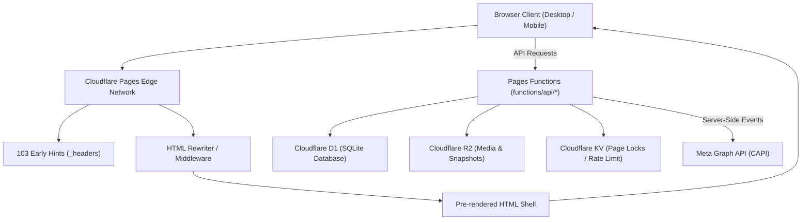
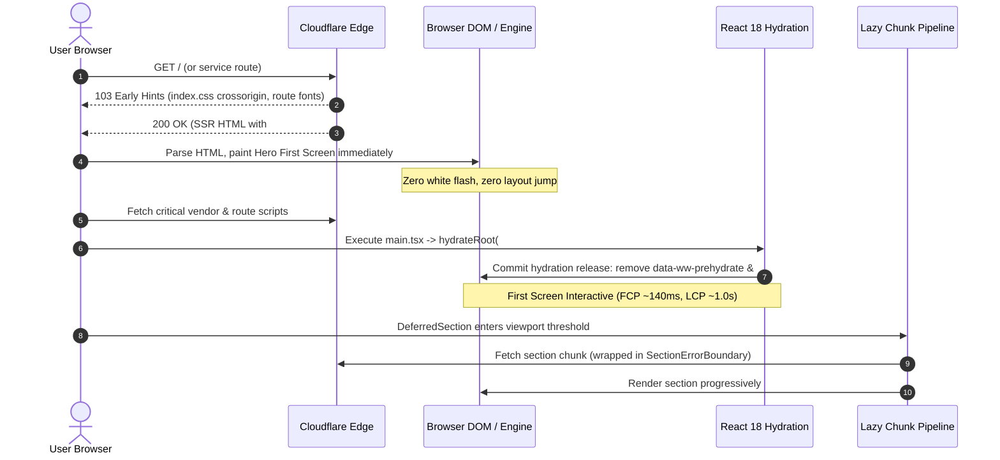

# ARCHITECTURE MAP: WHALEWZRD APPLICATION & EDGE INFRASTRUCTURE

## 1. System Topology & Layers

## 2. Frontend Critical Rendering & Hydration Path

## 3. Hero Animation Subsystem Pipeline

```mermaid
graph LR
    Admin["Admin CMS / Live Preview"] -->|titleLines config| Payload["Site Content Store / API"]
    Payload -->|fetch / seed| Page["Landing Page / Hero Component"]
    Page --> Resolve["resolveHeroTitleLines()"]
    Resolve -->|accumulated duration & safeSequenceGap| Engine["HeroTitleEffect.tsx"]
    Engine --> CSS["hero-title-effects.css"]
    CSS -->|background-image: inherit; -webkit-background-clip: text| Paint["GPU Compositor Paint"]
```

## 4. Resilience Architecture
1. **Network Fault Isolation**: `SectionErrorBoundary` surrounds each below-the-fold `DeferredSection`. If an offline condition or network blip occurs during scroll, the Hero and navigation remain 100% interactive. When `window.addEventListener('online')` fires, failed sections automatically reload.
2. **Chunk Version Mismatch Protection**: `RouteErrorBoundary` detects stale deployment chunks (`Failed to fetch dynamically imported module`), sets an anti-loop retry timestamp in URL parameter and sessionStorage, and reloads exactly once to fetch the latest manifest.
3. **Lead Capture Durability**: `leadRetryQueue` writes every submission to `localStorage` before initiating network fetch. If offline or Turnstile is unavailable, submissions are retained and scheduled for retry with exponential backoff upon network restoration or `visibilitychange`.
4. **Data Privacy & Strict Meta Gate**: If visitor grants analytics but declines marketing (`marketing_consent: false`), `pageview` operates in `stats_only` mode without queuing D1 outbox rows or calling Meta CAPI.
