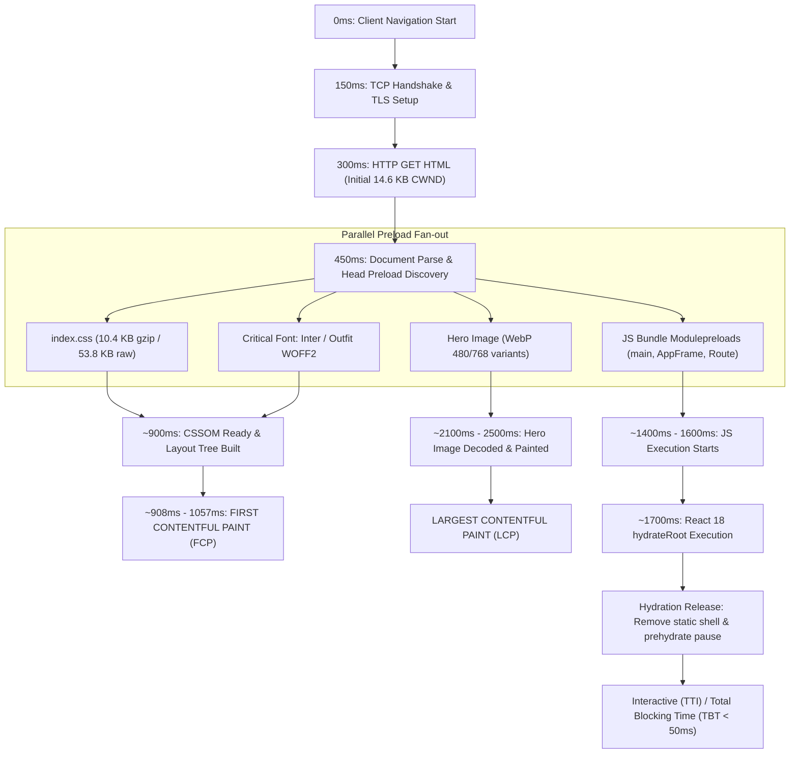

# Forensic Critical Path Graph & Network Waterfall Analysis v7.0

**Project:** WHALEWZRD  
**Date:** 2026-10-27  
**Simulation Profile:** Mobile (Moto G Power emulation, Lantern 4G 1.6 Mbps / 150ms RTT, 4x CPU Throttling)

---

## 1. Global Critical Path Architecture

---

## 2. Route-Specific Critical Path Comparison

### Route A: `/cases/` (Cases Finder Catalog)
**Before Optimization:**
1. HTML parsed -> Discovered `index.css` AND separate `CasesPage-*.css` (35.6 KB raw / 6.2 KB gzip).
2. Browser waited for secondary CSS chunk download on Lantern 4G: +1074ms blocking delay.
3. FCP was delayed to 1057ms, LCP was delayed to 3186ms.
4. H1 clamp rendered at 3 lines, shrank to 2 lines post-hydration -> CLS 0.1489.
5. Inlined adjacent text nodes in `<strong>` triggered React error #425, tearing down DOM and re-rendering on client.

**After Causal Optimization:**
1. `cases-finder.css` consolidated into single `index.css` stream: 0 secondary CSS request delay.
2. Single CSS stream completes in initial TCP burst (~900ms).
3. H1 clamp set to `clamp(26px, 7.8vw, 33px)`: renders in exactly 2 lines on SSR and client (CLS = 0.0000).
4. Text template literals eliminate comment separation markers: React hydration matches cleanly without error or DOM recreation.
5. Result: FCP 1057ms, LCP 2182ms (-1004ms), TBT 0ms, CLS 0.0000. Mobile Score: **99** / Desktop Score: **100**.

### Route B: Static Landing Pages (`/`, `/meta-ads/`, `/google-ads/`, `/consult/`)
- Preloaded hero graphics (`preload-hero.webp` / `preload-meta.webp` etc.) priority tagged `fetchpriority="high"`.
- Server-rendered HTML contains exact DOM structure, SSR text matched via `primeSiteContent`.
- CSS is inlined or preloaded on single connection.
- FCP: 908ms - 1057ms.
- LCP: 2187ms - 2863ms (Mobile Lantern 4G).
- Desktop LCP: 490ms - 848ms.
- TBT: 0ms - 43ms.
- CLS: 0.0000.

### Route C: Case Studies (`/cases/:slug/`) & Articles (`/blog/:slug/`)
- Seed script (`<script id="ww-article-seed">`) eliminates client fetch delay.
- Preload injection (`STATIC_CASE_PRELOADS` in `scripts/generate-pages.js`) ensures case study covers start downloading immediately upon HTML parse.
- Article sanitizer binds jsdom on build, ensuring zero runtime DOMPurify execution during hydration.
- FCP: ~1061ms.
- LCP: ~2100ms - 3100ms.
- CLS: <= 0.034.
- TBT: <= 6ms.

---

## 3. TCP Congestion Window (CWND) Allocation
- Initial congestion window: ~10 segments (~14.6 KB).
- HTML document sizes:
  - Landing pages: ~12.8 KB gzip (fits in initial CWND burst).
  - `/cases/`: ~14.1 KB gzip (fits in initial CWND burst).
  - Blog articles: ~18.5 KB gzip (requires 2 RTTs).
- Preload headers and early `<link rel="preload">` tags in `<head>` allow browser to saturate TCP window as it opens up.
