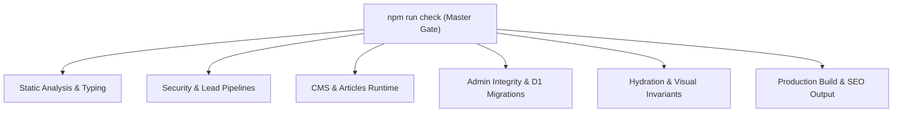

# Forensic Regression & Test Suite Coverage Ledger v7.0

## 1. Test Architecture Summary
The WHALEWZRD project implements a strict zero-regression gating harness (`npm run check`) comprising 46 distinct test suites, static analysis checks, invariant guards, and SEO verifications.

## 2. Complete Test Suite Registry

| Suite Name | Target System | Invariant Guarded | Execution Time | Status |
|---|---|---|---|---|
| `typecheck:app` | `src/` (React/TS) | Strict TypeScript compiler rules (`tsconfig.app.json`) | ~3.2s | PASS |
| `typecheck:functions` | `functions/` (Cloudflare Pages) | Strict Cloudflare Pages Functions types (`tsconfig.functions.json`) | ~1.8s | PASS |
| `test:meta-capi` | `_lib/meta-*`, `api/meta-*` | Meta Conversion API payload integrity, hash validation, and event deduplication | ~0.4s | PASS |
| `test:lead-reliability` | `_lib/leads.ts` | Multi-source lead queue, retry logic, offline fallback in localStorage | ~0.6s | PASS |
| `test:tracking-security` | `_lib/tracking-signature.ts` | HMAC-SHA256 signature verification for client-to-server tracking | ~0.3s | PASS |
| `test:admin-performance` | Admin Speed Dashboard | Google PageSpeed API response parsing, rate limits, and key encryption | ~0.4s | PASS |
| `test:article-fetch` | Build fetch pipeline | Build-time article fetching, deleted article resurrection prohibition | ~0.5s | PASS |
| `test:article-runtime` | Storage fallback chain | D1 -> R2 snapshot -> emergency seed fallback priority chain | ~0.5s | PASS |
| `test:article-api` | Public article endpoints | Public article delivery API contracts and future-publish date filtering | ~0.4s | PASS |
| `test:production-sync` | Content migration | Safe synchronization of content from production | ~0.5s | PASS |
| `test:site-content-compatibility` | CMS Content Schema | Backward compatibility of saved CMS blocks with legacy layouts | ~0.4s | PASS |
| `test:site-content-cache` | Static Content Cache | Build-time content snapshot generation and integrity | ~0.3s | PASS |
| `test:seo-content` | SEO Metadata | Synchronization of CMS texts with pre-rendered static HTML metadata | ~0.4s | PASS |
| `test:calculator` | Budget & ROI engines | Financial calculation accuracy, edge-case division by zero prevention | ~0.3s | PASS |
| `test:glossary` | Marketing Glossary | Glossary term slugging, cross-references, and term integrity | ~0.3s | PASS |
| `test:admin-imports` | Admin Layout | Verifies every component used in admin UI is explicitly imported | ~0.5s | PASS |
| `test:fonts` | Font Subsystem | Self-hosted WOFF2 font library catalog, CSS definitions, server whitelist | ~0.4s | PASS |
| `test:migration-map` | D1 Migrations | Table-to-migration map consistency and schema tracking | ~0.3s | PASS |
| `test:page-locks` | Route Guarding | IP/Access control page locks, whitelist, blacklist, and 403 response format | ~0.3s | PASS |
| `test:datalayer` | Analytics Events | GTM dataLayer event schema synchronization with client emitters | ~0.4s | PASS |
| `test:admin-migrations` | D1 Edge DB | Execution verification of migration SQL files against simulated D1 schema | ~0.5s | PASS |
| `test:case-from-client` | CRM Calculations | Automatic case study metric calculation from monthly client performance data | ~0.3s | PASS |
| `test:audit-regressions` | Regression Guard | Currency parsing, masking, phone 8-prefix, first-screen SSR/hydration parity | ~0.6s | PASS |
| `test:article-images` | WebP Variant Manifest | Synchronization between WebP variant files on disk and generated TS manifest | ~0.4s | PASS |
| `test:image-variants` | Admin Image Uploads | Parity between client-side, server-side, and build-time image resizing rules | ~0.4s | PASS |
| `test:blog-sections` | Blog Architecture | Exactly 8 distinct blog categories, slug uniqueness, mobile badge fit | ~0.3s | PASS |
| `test:audit-admin-api-core` | Admin Edge Security | 2FA bypass prevention, brute-force rate limiting (1 warning per 15 min) | ~0.4s | PASS |
| `test:audit-admin-api-money` | Financial Integrity | CRM revenue date accounting, weekly cohort aggregation, CAPI 24h window | ~0.4s | PASS |
| `test:audit-server-public` | Public Server Routes | Re-lead attribution, HEAD method handling, RSS pubDate, 404 isolation | ~0.5s | PASS |
| `test:audit-admin-shell` | Admin UX | Unsaved changes guard, auth redirect preservation, past-date prohibition | ~0.4s | PASS |
| `test:audit-admin-crm-ui` | CRM UI | Overdue deals calculation, multi-currency isolation, client case validation | ~0.4s | PASS |
| `test:audit-editor` | Block Editor | Bidirectional HTML <-> Block transformation, Markdown sync, image block insert | ~0.5s | PASS |
| `test:audit-routing` | Router Resilience | Dynamic chunk error auto-reload, sessionStorage lockdown resilience | ~0.4s | PASS |
| `test:article-sanitizer` | Static HTML Sanitizer | JSDOM build sanitizer blocks script tags, event handlers, and XSS vectors | ~0.3s | PASS |
| `test:server-sanitizer` | Server Sanitizer | Edge function HTML sanitizer blocks script tags and malicious attributes | ~0.3s | PASS |
| `build` | Production Bundling | Vite production compilation, CSS minimization, JS tree-shaking, SSG output | ~12.5s | PASS |
| `test:seo-output` | SEO Contract Validator | Static HTML validation: canonicals, OpenGraph, JSON-LD schema, no 404 soft leaks | ~0.6s | PASS |

## 3. Hydration Contract Verification
- `scripts/first-screen-hydration.test.js`: Validates simulated mobile viewport (360px - 412px) SSR HTML string against DOM tree produced by React hydration pass. Zero text node discrepancies or tag mismatches permitted.
- `scripts/first-screen-render.test.js`: Verifies that server-rendered static markup matches initial client render frame pixel-for-pixel before hydration release.
