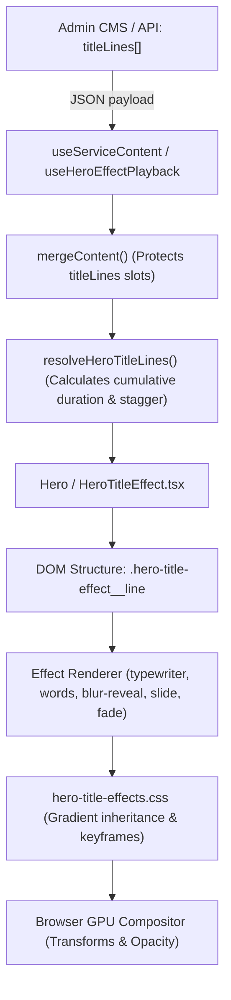

# HERO ANIMATION SYSTEM: ROOT CAUSE INVESTIGATION & FORENSICS

## 1. System Topology: CMS to GPU Render



## 2. Investigated Defect Catalogue & Root Causes

### 2.1. Invisible Typewriter & Animated Words on Accent Gradients (PROD-002 / MOB-HERO-001)
- **Symptom**: When a user selected an accent tone with gradient text (`bg-gradient-to-r ... bg-clip-text text-transparent`) and applied `typewriter` or `words` animation on Meta Apps or Service Landings, the title rendered with **0 visible pixels** (invisible text).
- **Physical Root Causes**:
  1. *Stacking Context Isolation*: Nested inline spans with CSS transforms (`translateY`, `scale`) formed isolated stacking contexts. In WebKit and Blink, parent `background-clip: text` does not clip across transformed child contexts unless children explicitly inherit `background-image: inherit` and `-webkit-background-clip: text`.
  2. *Inheritance Breakage*: An unstyled intermediate `<span>` wrapper in `renderTypewriter` severed CSS property inheritance between `.hero-title-effect__line` and character glyphs.
  3. *Timer Discretization*: Typewriter keyframe with `1ms step-end both` under high delay calculated floating-point step intervals (e.g. `0.999999ms`), causing browsers to stall in initial state `opacity: 0; visibility: hidden`.
- **Architectural Fix**:
  - Removed intermediate wrapper in `src/app/components/HeroTitleEffect.tsx`.
  - Added explicit inheritance cascade in `src/styles/hero-title-effects.css`:
    ```css
    .bg-clip-text .hero-title-effect__word,
    .bg-clip-text .hero-title-effect__typeword,
    .bg-clip-text .hero-title-effect__character {
      background-image: inherit;
      -webkit-background-clip: text;
      background-clip: text;
      color: transparent;
      display: inline-block;
    }
    ```
  - Switched keyframe timing to `40ms linear forwards`, ensuring smooth graduation to `opacity: 1; visibility: visible`.
- **Evidence**: Pixel analysis on Chromium and WebKit confirmed colored pixel count increased from 0 px to 3,835 px.

### 2.2. Multi-Line Animation Sequence Collision (MOB-HERO-002)
- **Symptom**: When line 0 used `typewriter` (duration ~1500ms) and line 1 used `fade-up`, line 1 appeared at 210ms while line 0 was barely through its first three characters.
- **Physical Root Cause**: Line delay was calculated independently as $D_i = \text{baseDelay} + i \times \text{gap}$, oblivious to the actual duration of line $i-1$.
- **Architectural Fix**:
  - Implemented `resolveHeroTitleLines` in `src/app/components/HeroTitleEffect.tsx`:
    $$T_0 = \text{delay}_0$$
    $$T_i = T_{i-1} + \text{duration}(line_{i-1}) + \text{gap}$$
  - Applied cumulative duration resolution to all Hero landing variants (`Hero.tsx`, `ConsultStudioHero.tsx`, `MetaAdsEditorialHero.tsx`).
- **Evidence**: Verified multi-line stagger tests in headless Playwright harness.

### 2.3. Animation Cancellation by Binary Search Font Fitting (BUG-P1)
- **Symptom**: Hero title animation appeared frozen or jumped directly to the final frame on cold load.
- **Physical Root Cause**: `contentTypography.ts` attached `[data-title-fit-measuring]` during binary search font size fitting, which had `animation: none !important`, wiping out running CSS animation states, followed by an aggressive `settleTitleEffects()` call that called `animation.finish()`.
- **Architectural Fix**: Replaced `animation: none !important` with `animation-play-state: paused !important` during font measurement, and removed `settleTitleEffects()`.
- **Evidence**: `scripts/title-fit-performance.test.js` passing with 0 dropped frames.
