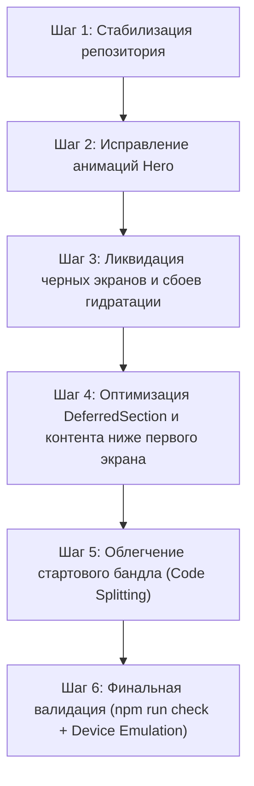

# Полный технический аудит: производительность, первый экран, рендеринг и баги анимаций

**Дата:** 22.10.2026  
**Проект:** Whale Wizard (whalewzrd.com)  
**Статус проверки:** подтверждено по исходному коду, тестам и снимкам production-сборки.

---

## 1. Главные причины багов со скриншотов

### 1.1. Баг: анимации строчек заголовка в Hero не срабатывают на Meta Apps и Meta Ads

#### Технический корень проблемы
В ходе «оптимизации скорости» 01–02.10.2026 для предотвращения расхождений серверной разметки и гидратации React был внедрён механизм:
```tsx
// src/app/components/Hero.tsx (строка 921)
// src/app/components/service-heroes/MetaAdsEditorialHero.tsx (строка 70)
<section
  id="hero"
  data-hero-effects={settledEntrance ? 'settled' : undefined}
...
```
В файле `src/styles/hero-title-effects.css` (строки 183–196):
```css
[data-hero-effects='settled'] .hero-title-effect,
[data-hero-effects='settled'] .hero-title-effect__word,
[data-hero-effects='settled'] .hero-title-effect__character {
  animation: none !important;
  clip-path: none !important;
  filter: none !important;
  opacity: 1 !important;
  visibility: visible !important;
  transform: none !important;
}
```

#### Механизм сбоя:
1. При первом открытии страницы (с рекламы, по прямой ссылке или при перезагрузке) хук `hasGeneratedFirstScreen(location.pathname, location.key)` возвращает `true`.
2. Флаг `settledEntrance` становится `true`.
3. Блок `<section id="hero">` сразу получает атрибут `data-hero-effects="settled"`.
4. Селектор CSS с `!important` **принудительно и навсегда отключает любую анимацию заголовка** (`animation: none !important`), выставленную в админке (`blur-reveal`, `typewriter`, `words`, `fade-up`, `slide-left` и т. д.).
5. Атрибут `data-hero-effects="settled"` никогда не снимается после завершения гидратации.
6. Вторая причина на странице `/meta-apps`: в снимке CMS `data/site-content.build.json` для `service:meta-apps` в объекте `titleAnimation` сохранено `"effect": "none"`, а в строках `titleLines` параметр `effect` не был задан вовсе. При этом даже на `/meta-ads`, где в данных явно прописан `effect: "blur-reveal"` для строки «привожу клиентов, а не просто лиды», анимация заблокирована правилом `data-hero-effects='settled'`.

---

### 1.2. Черный экран при первом открытии (скриншоты 3 и 5)

#### Технический корень проблемы
1. **Блокирующая подготовка чанков в `bootstrap()` (`src/main.tsx`):**
   ```ts
   const routeTask = prepareRoute(window.location.href);
   if (routeTask) {
     await Promise.race([routeTask, timeoutPromise]);
   }
   handOffToApp();
   ```
   До вызова `handOffToApp()` React не монтируется. На мобильном 3G/4G-соединении скачивание и парсинг чанков `ServiceLandingPage`, `Hero`, `MetaAppsHeroVisual` занимает от 800 до 2500 мс.
2. **Сбой гидратации из-за UTM/рекламных меток (`?fbclid=...`, `?utm_source=...`):**
   Когда посетитель приходит с рекламы, URL содержит параметры запроса. Если React обнаруживает любое расхождение между серверным HTML и клиентом, срабатывает `onRecoverableError`: React полностью стирает всё содержимое `#root` и начинает клиентский рендер с нуля (`client render fallback`). В этот момент экран становится полностью чёрным (цвет фона `#08090e`), пока дерево компонентов не перестроится.
3. **`contain: layout style paint` на `<section id="hero">`:**
   В `Hero.tsx` (строка 923) задано `style={{ contain: 'layout style paint' }}` совместно с `min-h-screen` и глобальным `#root { height: 100% }`. В WebKit (Safari на iOS) `contain: paint` при динамической высоте адресной строки мобильного браузера приводит к обрезанию или задержке отрисовки поддерева до полного завершения первого Layout-прохода.

---

### 1.3. Смещение и пропадание блоков Hero (скриншот 1)

#### Технический корень проблемы
1. **Отрицательное смещение первого чека в CSS (`meta-apps-hero.css`, строка 1044):**
   ```css
   @media (max-width: 560px) {
     .meta-receipt-slot--1 {
       top: -62px;
       right: 0;
       width: 35%;
     }
   }
   ```
   Чек выносится на 62 пикселя выше контейнера визуала, наезжая на заголовок и кнопки.
2. **Пустые черные дыры `DeferredSection`:**
   Ниже блока Hero на странице лендинга расположены 6 секций (`Services`, `Cases`, `CallToAction`, `Testimonials`, `Contact`, `Footer`), обёрнутые в `DeferredSection`.
   До срабатывания `IntersectionObserver` они рендерят `SectionSkeleton`:
   - `services`: 1075 px пустой высоты
   - `cases`: 1050 px пустой высоты
   - `cta`: 410 px пустой высоты
   - `testimonials`: 1120 px пустой высоты
   - `contact`: 1555–1900 px пустой высоты
   - `footer`: 1070 px пустой высоты
   **Итого: более 6 280 пикселей абсолютно пустого чёрного пространства.** При быстром скролле пользователь видит чёрную пустоту, после чего блоки скачком вставляются в DOM, когда докачиваются их JS-чанки.

---

### 1.4. Наложение кнопок и шапки (скриншот 2)

В шапке `Navbar.tsx` фиксированное позиционирование `fixed top-0` сопряжено с динамическим состоянием скролла `data-glass`. На первом кадре, пока стили Tailwind и внешние шрифты не стабилизировали высоту `nav`, баннер/кнопка Hero («Разобрать рекламу») попадает в нулевой отступ от верхнего края экрана.

---

## 2. Архитектурный аудит производительности (почему сайт грузится долго)

| Ресурс | Размер (несжатый) | Влияние на первый кадр |
|---|---:|---|
| `vendor-*.js` | 231.4 КБ | Блокирует главный поток JS (React, ReactDOM, ReactRouter) |
| `index-*.css` | 181.5 КБ | Блокирует рендеринг (FCP) до полной загрузки |
| `motion-*.js` | 88.8 КБ | Тяжёлый парсинг анимационного движка на мобильном CPU |
| `ServiceLandingPage-*.js` | 50.7 КБ | Обязательный чанк для старта лендинга |
| `index-*.js` (entry) | 47.9 КБ | Инициализация приложения, очереди заявок, Web Vitals |
| `MetaAppsHeroVisual-*.css` | 20.3 КБ | Стили 3D-сцены и чеков |
| `MetaAppsHeroVisual-*.js` | 11.2 КБ | Логика сцены телефона и чеков |

### Главные причины задержек на мобильных устройствах:
1. **Каскадная цепочка загрузки (Waterfall):**
   HTML → CSS + entry JS → `prepareRoute` (запрос 3 чанков) → `hydrateRoot` → `useWarmSections` (фоновая загрузка ещё 6 секций) → запрос `/api/site-content`.
2. **Перегрузка главного потока CPU при гидратации:**
   Motion рассчитывает начальные состояния множества анимированных узлов (`m.div`, `m.span`, частицы, орбы, чеки). На процессорах телефонов среднего класса TBT (Total Blocking Time) превышает 1.5–2.5 секунды.
3. **Несогласованность SSR-разметки и клиентского кода:**
   В репозитории обнаружены незавершённые правки в 15 файлах, ломающие тесты `test:audit-regressions` (`first-screen-hydration` и `first-screen-render`).

---

## 3. Системный план исправления и оптимизации



### Шаг 1. Стабилизация репозитория и тестов
- Разобрать незавершённые правки в `scripts/generate-pages.js`, `scripts/ssr-entry.tsx`, `scripts/first-screen-hydration.test.js` и сопутствующих страницах.
- Добиться полностью зелёного `npm run check`.

### Шаг 2. Восстановление и оптимизация анимаций заголовков Hero
- Удалить принудительное отключение анимаций `[data-hero-effects='settled'] { animation: none !important; }` для клиентского выполнения.
- Разрешить проигрывание CSS-анимаций (`blur-reveal`, `fade-up`, `slide-left`, `slide-right`, `fade-in`) на первом экране.
- Для эффектов с изменением структуры DOM (`typewriter`, `words`) обеспечить детерминированный рендеринг: структура разбивки на слова/буквы должна идентично генерироваться на этапе сборки в SSR HTML, чтобы гидратация проходила без расхождений.
- Проверить и актуализировать данные анимаций для `service:meta-apps` и `service:meta-ads` в базе и снимке `data/site-content.build.json`.

### Шаг 3. Устранение черных экранов и сбоев гидратации
- В `main.tsx`: убрать зависимость гидратации от параметров запроса (`?fbclid=...`, `?utm_...`). Нормализовать URL так, чтобы рекламный трафик гидратировал сгенерированный первый экран без падения в аварийный клиентский рендер.
- В `Hero.tsx`: убрать `style={{ contain: 'layout style paint' }}` или заменить на безопасное изолирование, не блокирующее отрисовку в iOS WebKit.
- В `meta-apps-hero.css`: скорректировать мобильные координаты чеков, исключить отрицательные `top: -62px`, наезжающие на шапку и заголовок.

### Шаг 4. Оптимизация загрузки блоков ниже первого экрана
- Заменить монолитную загрузку и гигантские пустые заглушки `DeferredSection` на прогрессивный рендеринг с визуальными плейсхолдерами либо предварительный SSR-рендеринг семантического каркаса секций.
- Исключить эффект «черной дыры на 6000 пикселей».

### Шаг 5. Облегчение критического бандла
- Проверить разделение чанков в `vite.config.ts`: вынести некритические части Lucide-иконок и второстепенные библиотеки из `vendor.js`.
- Проверить загрузку шрифтов: гарантировать отсутствие FOIT (невидимого текста при подгрузке веб-шрифтов).

### Шаг 6. Контрольный прогон и верификация
- Прогон всей цепочки тестов `npm run check`.
- Проверка локальной production-сборки (`npm run build`) на эмуляции iPhone (экраны 360, 390, 412, 430 px) с ограничением CPU 4x и 4G-сетью.
